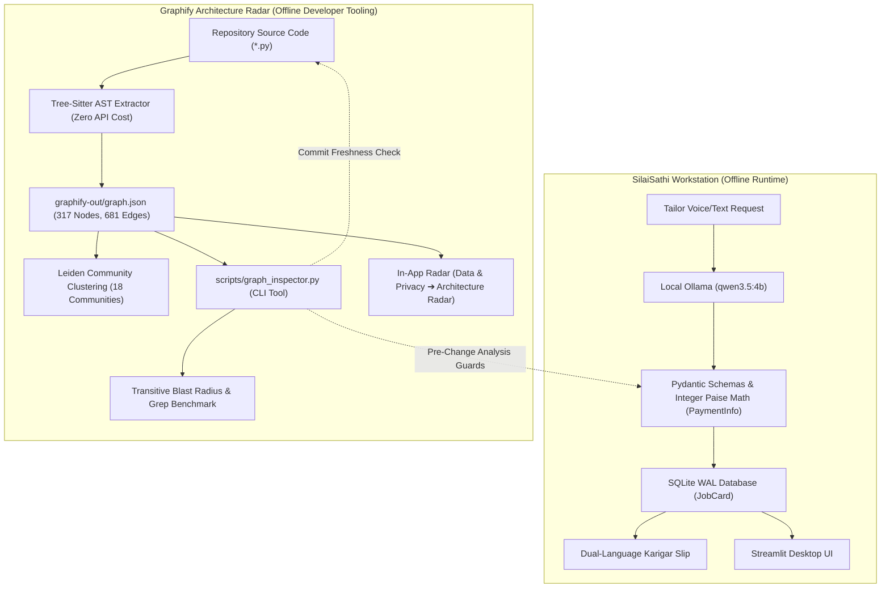

# SilaiSathi × Graphify: Pre-Mutation Architectural Radar & Knowledge Graph

**Event:** Hacktoberfest Hack Day Vadodara × NavraCommunity  
**Challenge Category:** Best Use of Graphify  
**Project:** SilaiSathi (सिलाईसाथी) — Offline-First AI Workstation for Independent Tailoring Shops  
**Repository:** https://github.com/dikshant363/silaisathi  
**Author:** Dikshant Agarwal  
**License:** MIT (Application) & Apache 2.0 (Graphify)  

---

## 1. Project Pitch

> **One-Line Pitch:**  
> *SilaiSathi integrates Graphify's offline AST knowledge graph into a privacy-first tailoring workstation, giving developers and AI coding agents an architectural radar that calculates transitive blast radius and prevents breaking changes across complex multi-module boundaries.*

### Why Open-Source AI & Local Knowledge Graphs Matter
Independent neighborhood tailoring boutiques (*darzis*) across India manage customer measurements and cash advances in Hindi and Hinglish. Cloud SaaS tools fail because workshops often lack continuous internet, and merchants refuse to leak customer body measurements and phone numbers to third-party cloud servers. 

SilaiSathi solves this with a **100% offline, local-first workstation** powered by local open-weight models (`qwen3.5:4b` via Ollama) and SQLite in WAL mode. But as a multi-stage deterministic safety pipeline, modifying a central symbol (like `PaymentInfo`, `JobCard`, or `POPULAR_MEASUREMENTS`) can cause silent runtime failures across validation, persistence, printing, and UI layers. 

By integrating **Graphify**, we turned our static codebase into an **offline 317-node, 681-edge directed architectural knowledge graph**. Before any mutation, developers and AI coding agents query the graph to calculate caller blast radiuses, verify commit freshness, and navigate exact dependency paths.

---

## 2. Architecture: Where Graphify Fits



---

## 3. Measurable Value: Empirical Benchmark (Graphify vs. Naive Grep)

In traditional code editing, developers rely on flat text search (`grep -rn "Symbol"`). Here is the empirical proof of why Graphify provides superior safety:

### Benchmark 1: Core Domain Abstraction (`PaymentInfo`)
```bash
python scripts/graph_inspector.py compare PaymentInfo
```

| Metric | Naive Grep | Graphify AST Graph | Impact on Development |
| :--- | :--- | :--- | :--- |
| **Total Occurrences / Symbols** | 51 text lines | 1 resolved AST node | Grep creates noisy output; Graphify isolates the exact symbol entity. |
| **Transitively Impacted Files** | 8 files (blind) | 10 distinct files mapped | Graphify surfaces hidden upstream files that don't literally mention the name. |
| **Comment / Docstring False Matches** | 2 lines | 0 (AST filtered) | Graphify completely ignores dead text and docstrings. |
| **Direct Callers Identified** | 0 (flat text) | 24 callers resolved | Grep cannot distinguish caller from callee; Graphify maps exact relations. |
| **Transitive Blast Radius** | None (unknown) | 51 upstream symbols | Graphify calculates the complete 2-hop ripple effect before mutating code. |

### Benchmark 2: Tracing the Real-World `POPULAR_MEASUREMENTS` Crash
When `POPULAR_MEASUREMENTS` was omitted from `silaisathi/config.py`, the Streamlit UI crashed on startup with an `ImportError`.
- **With Grep:** Searching `POPULAR_MEASUREMENTS` returned only lines in `app.py` with zero context on why or where it connected in the module hierarchy.
- **With Graphify:**
  ```bash
  graphify path "app.py" "silaisathi/config.py"
  ```
  Immediately revealed the 1-hop dependency: `app.py --imports_from [EXTRACTED]--> config.py`. Graphify pinpointed that `config.py` was the authoritative configuration hub for `app.py`.

---

## 4. Live Demonstration Script (Step-by-Step)

Judges and evaluators can reproduce the entire integration in under 60 seconds:

```bash
# 1. Activate isolated Python environment
source .venv/bin/activate

# 2. Verify graph freshness against git HEAD
python scripts/graph_inspector.py freshness
# -> Output: 🟢 Graph is FRESH (synchronized at commit ...)

# 3. View architectural summary and top 'God Nodes'
python scripts/graph_inspector.py summary
# -> Shows 317 symbols, 681 relationships, 18 communities, top hubs: JobCard, PaymentInfo

# 4. Inspect callers and outgoing dependencies of PaymentInfo
python scripts/graph_inspector.py inspect PaymentInfo
# -> Shows 24 inward callers across database.py, app.py, validation.py, and test files

# 5. Calculate pre-mutation blast radius before editing code
python scripts/graph_inspector.py blast-radius JobCard
# -> Shows 55 transitively impacted nodes across 10 files grouped by depth

# 6. Run the empirical comparison against flat text grep
python scripts/graph_inspector.py compare PaymentInfo
# -> Prints the side-by-side benchmark table

# 7. Run the automated test suite (all 39 tests passing)
pytest -v
```

### In-App Workstation Demo
1. Launch the local workstation:
   ```bash
   streamlit run app.py --server.address=127.0.0.1 --server.port=8501
   ```
2. Navigate to **Data & Privacy ➔ 🧭 Architecture & Graphify Radar**.
3. View live graph statistics, the God Nodes table, and test the interactive symbol dropdown to calculate blast radius right inside the browser UI.
4. Open `graphify-out/graph.html` or `graphify-out/GRAPH_TREE.html` for interactive 2D physics network and collapsible hierarchy trees.

---

## 5. Verification & Test Suite Summary

- **Automated Tests:** 39 passed in 0.49s (`tests/test_silaisathi.py` + `tests/test_graph_inspector.py`).
- **Code Linter:** Ruff 0.4+ passed (0 errors, 0 warnings across 21 files).
- **Network Isolation:** 0 external requests made; 100% offline verified via loopback socket guard (`tests/verify_offline_network.py`).
- **Streamlit Live Server:** Responding HTTP 200 OK on `127.0.0.1:8501/_stcore/health`.
