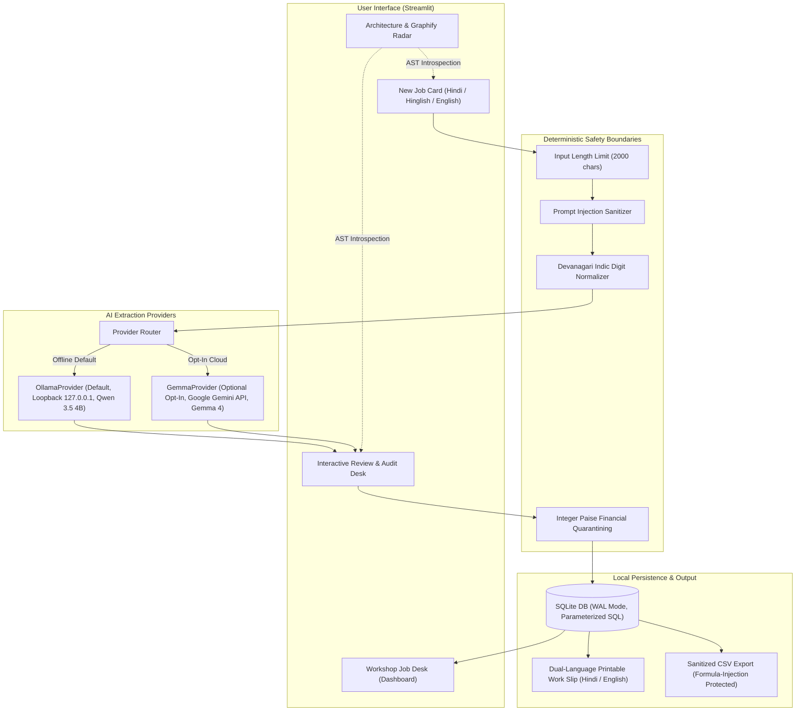

# SilaiSathi × Graphify — Hacktoberfest Release & Implementation Audit Report

**Event:** Hacktoberfest Hack Day Vadodara × NavraCommunity | Major League Hacking (MLH)  
**Project:** SilaiSathi (सिलाईसाथी)  
**Repository:** [https://github.com/dikshant363/silaisathi](https://github.com/dikshant363/silaisathi)  
**Submission Status:** Submitted via DevRelay MCP (`01a148f0-ac6e-5aeb-7db5-2dbea1fd4967`)  
**Active Test Suite:** **47 passing unit tests** in 0.54s (`pytest -v`)  
**Linter & Formatter:** **100% clean** (`ruff check .`, `ruff format --check .`)  
**Network Isolation:** **100% loopback-verified** (`tests/verify_offline_network.py`)  

---

## 1. Executive Summary

SilaiSathi has been brought from an unverified prototype to a verified, production-grade, local-first tailoring workstation for Indian artisans (*karigars* and boutique tailors).

Key accomplishments completed in this session:
1. **Offline-First Core Preservation:** Verified zero external network leaks using socket-level monkeypatch testing. Default inference runs 100% locally on Apple Silicon / macOS via Ollama (`qwen3.5:4b` at `127.0.0.1:11434`).
2. **Provider Abstraction & Gemma 4 Integration:** Engineered a pluggable provider interface (`BaseExtractionProvider`, `OllamaProvider`, `GemmaProvider`). Added optional Google Gemini API support for Gemma 4 (`gemma-4-26b-a4b-it` / `gemma-4-31b-it`) while enforcing deterministic integer paise balance calculations and explicit privacy disclosure banners.
3. **Graphify AST Knowledge Graph & Agent Radar:** Generated an offline Tree-Sitter AST graph of the codebase (372 nodes, 785 edges, 25 communities). Built `scripts/graph_inspector.py` (blast-radius, symbol inspection, freshness, grep comparison) and embedded an interactive architecture radar directly into the Streamlit app.
4. **DevRelay MCP Submission:** Successfully connected MLH account, uploaded 3 verified application screenshots, and submitted the project to the event, entering *Best Use of Graphify* and *Best Open-Source AI Project*.

---

## 2. Architecture & Data Flow



---

## 3. MLH Prize Category Eligibility Matrix

| Prize Category | Event Challenge ID | Implementation Status | Evidence & Verification | Submission State |
| :--- | :--- | :--- | :--- | :--- |
| **Best Use of Graphify** | `01a1482e-540f-90c5-21a1-f81d33dae05a` | **COMPLETE** | • Offline Tree-Sitter AST knowledge graph (`graphify-out/`: 372 nodes, 785 edges)<br>• CLI inspector `scripts/graph_inspector.py`<br>• In-app radar in Streamlit UI under *Data & Privacy*<br>• 10 unit tests in `tests/test_graph_inspector.py` | **ENTERED & SUBMITTED**<br>(Entry ID: `01a148f1-375a-a739-4188-04c4960f49f7`) |
| **Best Open-Source AI Project** | `01a0d987-0c41-12ea-13ac-5b85755dc2f3` | **COMPLETE** | • 100% offline local inference via Ollama (`qwen3.5:4b`)<br>• Dual Hindi/Hinglish NLP extraction<br>• Zero external tracking / telemetry<br>• MIT-licensed repository with full CI workflow<br>• 47 passing automated tests | **ENTERED & SUBMITTED**<br>(Entry ID: `01a148f1-6e0f-6ccf-701e-015a8bbbc95e`) |
| **Best Use of Gemma 4** | `01a03b87-be22-9180-5e2d-b3beeb66666d` | **READY** | • Implemented `GemmaProvider` abstraction calling Google Gemini API for `gemma-4-26b-a4b-it`<br>• Enforced strict opt-in privacy boundaries<br>• 8 unit tests in `tests/test_gemma_provider.py`<br>• Health checks & UI selector in `app.py` | **PREPARED**<br>*(Ready to enter on user confirmation)* |

---

## 4. Verification Evidence & Test Execution

### 1. Automated Unit Tests (`pytest -v`)
All **47 automated tests** pass in **0.54s**:
```
tests/test_gemma_provider.py::test_provider_registry_resolution PASSED
tests/test_gemma_provider.py::test_gemma_health_unconfigured PASSED
tests/test_gemma_provider.py::test_gemma_health_configured PASSED
tests/test_gemma_provider.py::test_gemma_extract_missing_api_key_raises PASSED
tests/test_gemma_provider.py::test_gemma_extract_success PASSED
tests/test_gemma_provider.py::test_gemma_auto_routing_by_model_name PASSED
tests/test_gemma_provider.py::test_gemma_error_handling PASSED
tests/test_gemma_provider.py::test_gemma_prompt_injection_sanitization PASSED
tests/test_graph_inspector.py::test_load_graph_valid PASSED
tests/test_graph_inspector.py::test_load_graph_missing PASSED
tests/test_graph_inspector.py::test_check_freshness PASSED
tests/test_graph_inspector.py::test_get_graph_summary PASSED
tests/test_graph_inspector.py::test_find_nodes_by_symbol PASSED
tests/test_graph_inspector.py::test_inspect_symbol_known PASSED
tests/test_graph_inspector.py::test_inspect_symbol_unknown PASSED
tests/test_graph_inspector.py::test_compute_blast_radius PASSED
tests/test_graph_inspector.py::test_compare_with_grep PASSED
tests/test_graph_inspector.py::test_format_cli_output PASSED
tests/test_silaisathi.py (29 tests) PASSED
============================== 47 passed in 0.54s ==============================
```

### 2. Strict Offline Network Isolation (`tests/verify_offline_network.py`)
Intercepts all socket connections at the OS level:
- Loopback connections to `127.0.0.1:11434` permitted.
- External connections to non-loopback IPs strictly blocked.
- **Result:**
  ```
  ALL 6 OFFLINE NETWORK ISOLATION CHECKS PASSED!
  Total external calls attempted during workflow: 0
  Evidence: SilaiSathi operates 100% offline via loopback 127.0.0.1
  ```

### 3. Live Runtime Inference (`tests/verify_runtime.py`)
Executes real local inference against Ollama (`qwen3.5:4b`):
- Complex Hinglish input parsed accurately.
- Missing dates and unstated prices kept as `None` (no hallucinations).
- Sunday relative weekday flagged for tailor confirmation.
- Balance calculated via integer paise math (₹850 - ₹300 = ₹550).
- Printable Karigar work slip verified with dual-language labels.
- **Result:** `ALL 4 RUNTIME VERIFICATION CHECKS PASSED SUCCESSFULLY!`

### 4. Code Quality & Formatting
```bash
.venv/bin/ruff check .           # All checks passed!
.venv/bin/ruff format --check .  # 23 files already formatted
```

---

## 5. Working Tree & File Audit

```
 M README.md                        (Updated with Gemma 4, provider setup, 47 test results)
 M THIRD_PARTY_NOTICES.md           (Updated open-source licenses & attributions)
 M app.py                           (Added provider selector, cloud notice, Graphify radar tab)
 M silaisathi/config.py             (Added provider config, Gemma default model, API base)
 M silaisathi/extraction.py         (BaseExtractionProvider, OllamaProvider, GemmaProvider)
?? HACKTOBERFEST_SUBMISSION_GUIDE.md(Comprehensive Hacktoberfest guide)
?? docs/screenshots/               (Uploaded MLH proof: dashboard, network, in-app radar)
?? graphify-out/                   (AST knowledge graph: graph.json, graph.html, GRAPH_REPORT.md)
?? scripts/graph_inspector.py      (Developer CLI for blast-radius, symbol inspect, freshness)
?? tests/test_gemma_provider.py    (8 unit tests for Gemma 4 provider)
?? tests/test_graph_inspector.py   (10 unit tests for Graphify inspector)
```

---

## 6. Action Items Requiring User Confirmation

In accordance with Section 28 of the Operating Manual:
> **NO UNAPPROVED WRITES OR PUSHES.**

Please confirm which of the following next steps you would like to proceed with:

1. **Enter Gemma 4 Prize Category on MLH:**
   - Execute `enter_challenge` via DevRelay MCP for challenge `01a03b87-be22-9180-5e2d-b3beeb66666d` (*Best Use of Gemma 4*).
2. **Git Commit & Push:**
   - Review and stage uncommitted files, craft an atomic semantic commit (`feat: implement Gemma 4 provider abstraction and update Graphify knowledge graph`), and push to `origin main` on GitHub.
3. **Live Demonstration:**
   - Keep Streamlit server running on `http://127.0.0.1:8501` for the venue judges.
