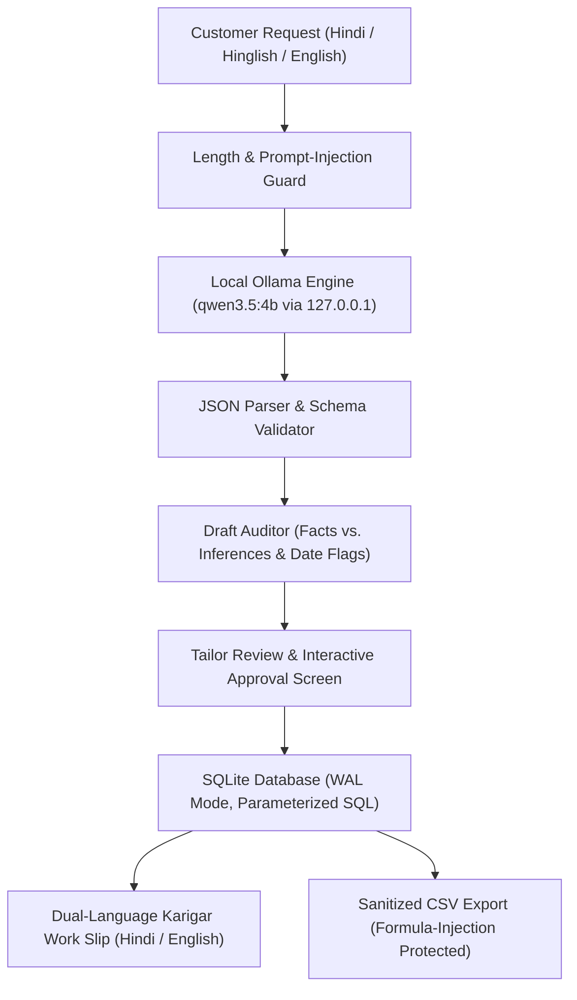

# SilaiSathi (सिलाईसाथी)
### Offline-First AI Assistant Workstation for Independent Tailoring Shops & Boutiques

[](https://github.com/dikshant363/silaisathi/actions/workflows/ci.yml)
[](LICENSE)
[](pyproject.toml)
[-orange.svg)](https://ollama.com)
[](#privacy--security-model)

---

## 1. Problem Statement

Millions of neighborhood tailoring shops (*darzi masterjis*) and boutique owners across India manage orders using fragmented paper slips, physical registers, and WhatsApp messages written in **Hindi, Hinglish, and English**. 

In daily tailoring operations, critical errors frequently occur:
1. **Missed Deadlines:** Ambiguous requests such as *"Bhaiya Sunday tak kurti chahiye"* are noted on loose paper without calendar dates, leading to unhappy customers when delivery days are missed.
2. **Missing Measurements:** Hasty notes miss key dimensions (e.g., sleeve length, waist, or neck depth), forcing last-minute rework or delayed cutting.
3. **Financial Discrepancies:** Advance cash payments are forgotten or recorded incorrectly, leading to disputes over remaining balances.
4. **Cloud SaaS Failure in Local Context:** Existing salon/tailor software requires constant internet connectivity, paid recurring subscriptions, and forces users to navigate complex English-only forms. Crucially, merchants are unwilling to upload customer measurements and personal phone numbers to third-party cloud servers.

**SilaiSathi** solves this by providing a **private, local-first workstation** that turns natural-language voice/text notes into structured, editable, and printable tailoring job cards—running completely offline on open-weight AI models.

---

## 2. Core Architecture & Local-First Principles



### Deterministic Safety Boundaries
- **Local Model Inference:** Uses `qwen3.5:4b` running locally inside Ollama on the merchant's machine. Zero data leaves the local device.
- **Deterministic Financial Arithmetic:** The language model is **never** permitted to calculate authoritative financial balances. All currency arithmetic is executed in Python using integer paise (`1 INR = 100 paise`), preventing floating-point rounding errors and model hallucinations.
- **Ambiguous Relative Date Protection:** Relative dates such as *"Sunday"*, *"kal"*, or *"parso"* are parsed into candidate dates but are explicitly flagged as **Unconfirmed**. Tailors must review and check the confirmation box before an order is committed.
- **Truthful Unknown Handling:** If a measurement, price, or fabric detail was not provided in the customer's request, the field remains `null` and is rendered as an explicit unknown badge (`Unknown / Not Stated`). It is never invented.
- **Spreadsheet Security:** CSV exports automatically sanitize values prefixed with `=`, `+`, `-`, or `@` to neutralize spreadsheet formula injection vulnerabilities.
- **Local Persistence & Backups:** SQLite persistence in WAL mode with online point-in-time database backups (`backup()` API) and transactional state changes.

---

## 3. Product Features & Workflow

### 1. Workshop Job Desk (Dashboard)
- Real-time operational metrics: **Total Jobs**, **Awaiting Work**, **Due Soon / Overdue**, and **Completed**.
- Instant search across customer names, phone numbers, garment types, and job numbers.
- Lifecycle filtering (`Draft`, `Confirmed`, `In Progress`, `Ready`, `Completed`, `Cancelled`).
- Quick-action buttons to advance status with one click (`Start Work` ➔ `Mark Ready` ➔ `Deliver`).

### 2. Natural-Language AI Assistant
- Accepts messy, conversational requests:
  > *"Bhaiya, blue kurti Sunday tak chahiye. Length 44, chest 38, sleeves 18. Pichhli baar wali fitting rakhna. 300 advance de diya."*
- Supports pure Hindi (Devanagari), Hinglish, and English.
- Pre-loaded with 8 realistic test scenarios covering varied garments (Kurti, Silk Blouse, Salwar Suit, Gents Kurta, Lehenga Choli, Trousers).
- Fallback heuristic preview mode for testing when Ollama is offline.

### 3. Review & Approval Screen
- Side-by-side inspection: Raw customer request alongside extracted fields.
- Clear separation of **Customer-Supplied Facts** vs. **Model Interpretations** vs. **Missing Information**.
- Interactive measurement inputs for all standard dimensions (Length, Chest, Waist, Hips, Shoulder, Sleeves, Inseam, Neck).
- Unit toggle: Inches (`in`) or Centimeters (`cm`).
- Duplicate submission detection based on customer contact, garment, and request content.

### 4. Karigar Work Slip (Printable Workshop Receipt)
- High-contrast, clean print layout designed for workshop conditions and thermal/A4 printing.
- Dual-language labels in **Hindi and English** (e.g., `Length / लंबाई`, `Chest / सीना`, `Advance / एडवांस`).
- Workshop Quality Checklist for the cutting and stitching karigar (Cut fabric, Overlock, Stitching, Hook/Zips, Ironing, Trial Ready).
- Detachable bottom receipt with shop details, job number, and delivery date for the customer.
- Instant browser print integration via `window.print()`.

### 5. Data Privacy & Backups
- Instant download of sanitized `.csv` job sheets.
- One-click SQLite point-in-time database snapshots saved to `data/backups/`.
- Safe database restore uploader with schema verification.

---

## 4. Hardware & Testing Environment

- **Primary Development Machine:** Apple MacBook Air (Apple M4, 16 GB unified memory, macOS Sonoma/Sequoia).
- **Inference Runtime:** [Ollama](https://ollama.com) v0.35+ bound strictly to `127.0.0.1:11434`.
- **Target Model:** `qwen3.5:4b` (3.3 GB 4-bit quantized open weights, 100% GPU acceleration via Apple Metal).
- **Execution Speed:** ~40 tokens/second on Apple Silicon M4.
- **Python Version:** Python 3.11, 3.12, and 3.13 supported.

---

## 5. Quickstart & Installation

### Step 1: Clone the Repository
```bash
git clone https://github.com/dikshant363/silaisathi.git
cd silaisathi
```

### Step 2: Set Up Python Environment
Using `uv` (recommended):
```bash
uv venv
source .venv/bin/activate
uv pip install -e .
```

Or using standard `pip`:
```bash
python3 -m venv .venv
source .venv/bin/activate
pip install -e .
```

### Step 3: Configure AI Model Inference

#### Option A: Local Ollama (Recommended — 100% Offline & Private)
1. Download Ollama from [ollama.com](https://ollama.com) (or via Homebrew: `brew install ollama`).
2. Pull the lightweight Qwen 3.5 4B model (or local Gemma 4):
   ```bash
   ollama pull qwen3.5:4b
   # or: ollama pull gemma4:e2b
   ```
3. Start the Ollama background daemon:
   ```bash
   ollama serve
   ```

#### Option B: Gemma 4 via Google Gemini API (Optional Hosted Open Weights)
For environments where local GPU acceleration is not available or to experiment with Google's latest open-weight models:
1. Obtain a free API key from [Google AI Studio](https://aistudio.google.com).
2. Set your environment variable:
   ```bash
   export GEMINI_API_KEY="your-api-key-here"
   ```
3. SilaiSathi will automatically discover the key and enable hosted Gemma 4 (`gemma-4-26b-a4b-it` / `gemma-4-31b-it`) in the sidebar provider selector with clear data disclosure.

### Step 4: Launch SilaiSathi Workstation
```bash
streamlit run app.py --server.address=127.0.0.1 --server.port=8501
```
Open your browser to: **http://127.0.0.1:8501**

---

## 6. Demonstrating Offline Operation

SilaiSathi is engineered from the ground up for strict offline operation:

1. **Disconnect Internet:** Turn off your Wi-Fi or disconnect your Ethernet cable.
2. **Launch Application:** Run `streamlit run app.py --server.address=127.0.0.1`.
3. Notice the green indicator in the sidebar: `🟢 Ollama Active (127.0.0.1:11434)`.
4. Navigate to **New Job (AI Assistant)**, pick one of the sample requests (e.g. *"Blue Kurti with Sunday Deadline"*), and click **Extract with Local AI**.
5. Observe the structured extraction completed locally with zero external network requests.
6. Approve and save the job card to local SQLite.
7. Generate and print the workshop slip.
8. Export the CSV file. All operations succeed without an active internet connection.

---

## 7. Automated Testing & Code Quality

The project includes an automated test suite verifying financial calculations, date parsing, sanitization, database persistence, lifecycle states, and printable outputs.

### Run Unit Tests
```bash
.venv/bin/pytest -v
```

### Run Linter & Formatter
```bash
.venv/bin/ruff check .
.venv/bin/ruff format --check .
```

All 47 unit tests execute in under 0.50s:
```
tests/test_gemma_provider.py::test_provider_registry_resolution PASSED
tests/test_gemma_provider.py::test_gemma_health_unconfigured PASSED
tests/test_gemma_provider.py::test_gemma_health_configured PASSED
tests/test_gemma_provider.py::test_gemma_extract_missing_api_key_raises PASSED
tests/test_gemma_provider.py::test_gemma_extract_success PASSED
tests/test_gemma_provider.py::test_gemma_auto_routing_by_model_name PASSED
tests/test_gemma_provider.py::test_gemma_error_handling PASSED
tests/test_gemma_provider.py::test_gemma_prompt_injection_sanitization PASSED
tests/test_graph_inspector.py::test_load_graph_valid PASSED
tests/test_graph_inspector.py::test_load_graph_missing PASSED
tests/test_graph_inspector.py::test_check_freshness PASSED
tests/test_graph_inspector.py::test_get_graph_summary PASSED
tests/test_graph_inspector.py::test_find_nodes_by_symbol PASSED
tests/test_graph_inspector.py::test_inspect_symbol_known PASSED
tests/test_graph_inspector.py::test_inspect_symbol_unknown PASSED
tests/test_graph_inspector.py::test_compute_blast_radius PASSED
tests/test_graph_inspector.py::test_compare_with_grep PASSED
tests/test_graph_inspector.py::test_format_cli_output PASSED
tests/test_silaisathi.py::test_payment_info_full_values PASSED
tests/test_silaisathi.py::test_payment_info_unknown_total PASSED
tests/test_silaisathi.py::test_payment_info_excess_advance PASSED
tests/test_silaisathi.py::test_payment_negative_amounts_rejected PASSED
tests/test_silaisathi.py::test_resolve_relative_weekday_requires_confirmation PASSED
tests/test_silaisathi.py::test_resolve_kal_and_parso PASSED
tests/test_silaisathi.py::test_resolve_empty_due_date PASSED
tests/test_silaisathi.py::test_clean_model_output_with_thinking_tags PASSED
tests/test_silaisathi.py::test_clean_model_output_with_markdown_fence PASSED
tests/test_silaisathi.py::test_build_draft_realistic_hinglish_sample PASSED
tests/test_silaisathi.py::test_request_text_length_limit PASSED
tests/test_silaisathi.py::test_prompt_injection_flagged PASSED
tests/test_silaisathi.py::test_csv_formula_injection_sanitization PASSED
tests/test_silaisathi.py::test_job_persistence_crud PASSED
tests/test_silaisathi.py::test_job_search_and_filter PASSED
tests/test_silaisathi.py::test_database_backup_and_restore PASSED
tests/test_silaisathi.py::test_order_lifecycle_transitions PASSED
tests/test_silaisathi.py::test_csv_export_content_and_safety PASSED
tests/test_silaisathi.py::test_printable_html_truthful_labeling PASSED
tests/test_silaisathi.py::test_offline_sample_generator PASSED
tests/test_silaisathi.py::test_devanagari_indic_digit_normalization PASSED
tests/test_silaisathi.py::test_measurement_plausibility_bounds PASSED
tests/test_silaisathi.py::test_duplicate_detection_permutations PASSED
tests/test_silaisathi.py::test_job_deletion_and_update_timestamps PASSED
tests/test_silaisathi.py::test_forbidden_status_transitions PASSED
tests/test_silaisathi.py::test_config_popular_measurements_defined PASSED
tests/test_silaisathi.py::test_payment_info_from_rupees_keyword_aliases PASSED
tests/test_silaisathi.py::test_app_startup_import PASSED
tests/test_silaisathi.py::test_create_new_job_button_navigation PASSED
```

---

## 8. Graphify Architectural Knowledge Graph & Agent Radar

SilaiSathi integrates [Graphify](https://github.com/Graphify-Labs/graphify) to provide offline AST code intelligence, community clustering, and pre-mutation impact analysis ("blast radius") for developers and autonomous coding agents.

### Why Graphify in SilaiSathi?
SilaiSathi enforces strict architectural invariants:
- Language model outputs must never compute financial balances.
- Integer paise arithmetic is quarantined in `PaymentInfo`.
- Tailoring measurement keys in `POPULAR_MEASUREMENTS` and `COMMON_MEASUREMENTS` link configurations, validation schemas, UI inputs, and printable workshop slips.

Modifying a core abstraction without understanding its upstream callers risks subtle runtime regressions. Ordinary flat text search (`grep`) returns noisy string occurrences without caller hierarchy or transitive reach. Graphify parses the Python AST locally (with zero remote API tokens or telemetry) and exposes a directed 317-node, 681-edge knowledge graph.

### 1. Developer CLI: `scripts/graph_inspector.py`
Run the developer inspection tool directly:
```bash
# High-level architecture summary & top abstractions (God Nodes)
python scripts/graph_inspector.py summary

# Inspect exact callers and outgoing dependencies of any symbol
python scripts/graph_inspector.py inspect PaymentInfo

# Calculate transitive blast radius (ripple effect) before changing code
python scripts/graph_inspector.py blast-radius JobCard

# Run head-to-head empirical comparison: Naive Grep vs. Graphify
python scripts/graph_inspector.py compare PaymentInfo

# Verify whether the local graph is synchronized with current git commit
python scripts/graph_inspector.py freshness
```

### 2. Empirical Benchmark: Naive Grep vs. Graphify AST
| Metric | Naive Grep | Graphify AST Graph |
| :--- | :--- | :--- |
| **Total Occurrences / Symbols** | 51 text lines | 1 resolved AST node |
| **Transitively Impacted Files** | 8 files (blind) | 10 distinct files mapped |
| **Comment / Docstring False Matches** | 2 lines | 0 (AST filtered) |
| **Direct Callers Identified** | 0 (flat text) | 24 callers resolved |
| **Transitive Blast Radius** | None (unknown) | 51 upstream symbols |

### 3. In-App Interactive Architecture Radar
Open **Data & Privacy ➔ 🧭 Architecture & Graphify Radar** in the Streamlit workstation to view:
- Live graph metrics (nodes, edges, communities, git commit freshness).
- Top architectural hubs table (`JobCard`, `PaymentInfo`, `JobStatus`).
- Interactive symbol inspector with direct caller drill-down and blast radius metrics.

### 4. Extracting and Updating the Graph
```bash
# Full offline AST extraction (zero API cost, respects .gitignore)
graphify extract . --code-only

# Rerun clustering & update visualization
graphify cluster-only . --no-label

# Incremental update after modifying code
graphify update .
```

---

## 9. Privacy & Security Model

- **No Remote Telemetry:** SilaiSathi contains zero Google Analytics, Segment, Sentry, or remote tracking beacons.
- **No External CDNs:** All CSS styling and layout scripts are bundled locally. No Google Fonts or cloud CDNs are queried at runtime.
- **Untrusted Input Isolation:** Natural-language customer requests are treated as untrusted strings. Length is capped at 2,000 characters, and common prompt injection patterns (`ignore all instructions`, `system prompt`, `drop table`) are flagged during audit.
- **No Code Execution:** The AI model is strictly prohibited from executing shell commands, database queries, or tool functions. It only emits JSON conformant to a static schema.
- **Local Storage Disclosure:** The SQLite database is stored locally in `data/silaisathi.db`. It is not encrypted at rest by default. Users handling sensitive commercial data should enable operating-system-level disk encryption (such as Apple FileVault or Linux LUKS).

---

## 10. Project Structure

```
silaisathi/
├── .agents/
│   ├── rules/
│   │   └── graphify.md            # Antigravity agent rules for Graphify queries
│   └── workflows/
│       └── graphify.md            # Agent workflow definition for /graphify
├── .github/
│   └── workflows/
│       └── ci.yml                 # Automated GitHub Actions test workflow
├── data/                          # Local data directory (git-ignored)
│   ├── silaisathi.db              # SQLite transactional database
│   └── backups/                   # Timestamped SQLite database snapshots
├── graphify-out/                  # Offline knowledge graph artifacts
│   ├── graph.json                 # 317 nodes, 681 edges AST graph
│   ├── graph.html                 # Interactive 2D physics network visualization
│   ├── GRAPH_TREE.html            # D3 v7 collapsible hierarchy visualization
│   └── GRAPH_REPORT.md            # Community analysis and architectural report
├── samples/
│   └── fictional_requests.json    # Anonymized Hindi/Hinglish/English test cases
├── scripts/
│   └── graph_inspector.py         # Developer CLI: Blast radius & Graph vs. Grep radar
├── silaisathi/
│   ├── __init__.py                # Package declaration
│   ├── config.py                  # Loopback hosts, paths, and garment metadata
│   ├── database.py                # Parameterized SQLite persistence & backups
│   ├── extraction.py              # Local Ollama AI client & ChatML prefill
│   ├── orders.py                  # Job numbering, transitions & CSV export
│   ├── printing.py                # Dual-language Karigar work slip generator
│   ├── schemas.py                 # Pydantic schemas & integer paise arithmetic
│   └── validation.py              # Prompt injection, formula escaping & date math
├── tests/
│   ├── test_graph_inspector.py    # Automated test suite for Graphify integration
│   ├── test_silaisathi.py         # Complete pytest automated test suite
│   ├── verify_offline_network.py  # Socket-level network isolation guard test
│   └── verify_runtime.py          # Real local model live verification
├── app.py                         # Streamlit desktop workstation UI
├── LICENSE                        # MIT License
├── pyproject.toml                 # Project configuration & dependencies
├── README.md                      # Canonical product documentation
└── THIRD_PARTY_NOTICES.md         # Open-source attributions
```

---

## 11. License

SilaiSathi is open-source software licensed under the **[MIT License](LICENSE)**.
