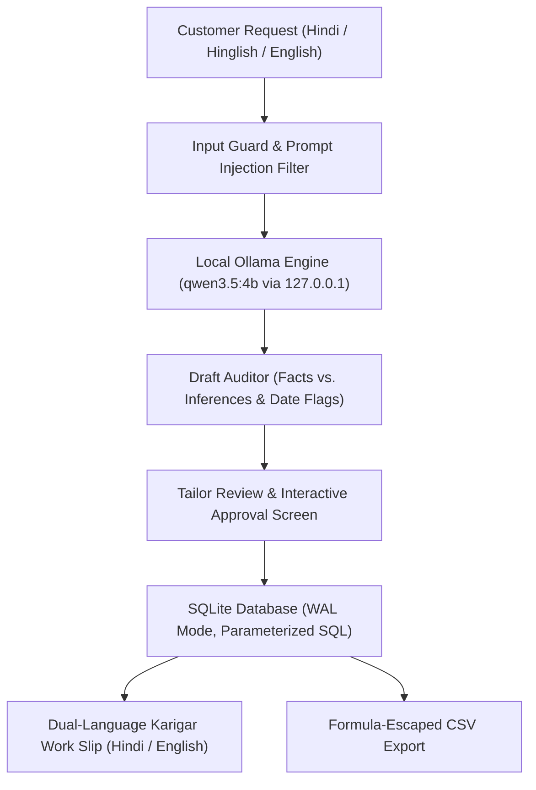

*This article is submitted for the [DEV Hacktoberfest 2026 Open-Source AI Challenge: Week 2 (Side Hustle)](https://dev.to/challenges/hacktoberfest-2026).*

---

## What I Built

Across India and South Asia, millions of neighborhood tailors (*darzi masterjis*) and boutique owners operate essential local businesses. Yet, their daily order management still relies on loose paper chits, handwritten registers, and chaotic WhatsApp voice notes written in **Hindi, Hinglish, and conversational English**.

In high-volume tailoring shops, three operational failures repeatedly drain profit margins:
1. **Missed Delivery Deadlines:** Notes like *"Bhaiya Sunday tak kurti chahiye"* are jotted down on scrap paper without calendar dates. When Sunday arrives and the garment isn't ready, customer trust is damaged.
2. **Missing Cutting Dimensions:** Rushed notes often miss critical measurements (e.g., sleeve length, waist, or neck depth), discovered only when the *karigar* (craftsman) is already at the cutting table.
3. **Cash Advance & Balance Disputes:** In cash-based shops, unrecorded or miscalculated advance deposits lead to disputes upon garment delivery.
4. **Cloud SaaS Failure in Real-World Workstations:** Existing salon and boutique software requires expensive recurring subscriptions, demands persistent high-speed internet, and forces tailors to upload private customer measurements and phone numbers to foreign cloud servers.

### Enter SilaiSathi (सिलाईसाथी)

**SilaiSathi** is an **offline-first, private desktop workstation** that empowers independent tailors and small boutiques to turn messy natural-language requests into structured, verified, and printable tailoring job cards—running **100% locally** on open-weight AI models.



### Core Capabilities
- **Local Multilingual AI Extraction:** Understands conversational Hindi, Hinglish, and English requests, parsing garment types, colors, fabrics, measurements, fitting preferences, and advance cash deposits.
- **Strict Deterministic Financial Arithmetic:** The AI model is strictly prohibited from computing authoritative balances. All money calculations are executed deterministically in Python using integer paise (`1 INR = 100 paise`), eliminating floating-point rounding errors and LLM hallucinations.
- **Ambiguous Relative Date Protection:** Phrases like *"Sunday tak"*, *"kal"*, or *"parso"* are parsed into prospective dates but explicitly flagged as **Unconfirmed**. The tailor must verify and check the confirmation box before saving.
- **Truthful Unknown Handling:** If a measurement, price, or fabric detail was not provided in the customer's request, the field remains `null` and is rendered as an explicit unknown badge (`Unknown / Not Stated`). It is never invented.
- **Dual-Language Karigar Work Slip:** Generates high-contrast, thermal/A4-ready physical workshop slips with bilingual labels (English and Hindi), a 6-stage craftsman quality checklist, and a detachable bottom customer receipt.
- **Zero Cloud Dependence:** Built to run strictly offline on consumer laptops (developed on an Apple MacBook Air M4 with 16 GB memory) with zero telemetry, zero remote CDNs, and zero third-party API keys.

---

## Demo

<!-- DEMO_VIDEO_URL_PLACEHOLDER: Add your recorded Loom/YouTube demo URL here -->
> **Live Demo Video Placeholder:** [Watch the 2-Minute SilaiSathi Walkthrough on YouTube](https://youtu.be/placeholder-demo-silaisathi)  
> *(A reproducible step-by-step demonstration script is available in [`docs/DEMO_SCRIPT.md`](https://github.com/dikshant363/silaisathi/blob/main/docs/DEMO_SCRIPT.md)).*

### 2-Minute Walkthrough Summary:

1. **Paste Messy Customer Request:**
   > *"Bhaiya, blue kurti Sunday tak chahiye. Length 44, chest 38, sleeves 18. Pichhli baar wali fitting rakhna. 300 advance de diya."*
2. **Local AI Extraction (1.6s on Apple Silicon):**
   - Garment: `Kurti (Blue)`
   - Measurements: `Length: 44.0 in`, `Chest: 38.0 in`, `Sleeves: 18.0 in`
   - Advance Paid: `₹300.00`
   - Total Price: `None` (Truthfully preserved as unknown)
3. **Safety Review:**
   - Notice the yellow alert: `Candidate relative day 'Sunday' points to 18 Oct 2026. Requires confirmation.`
   - Notice the financial alert: `Total price not stated — Balance pending price confirmation.`
   - Tailor sets stitching price: `₹850.00`.
   - Deterministic balance calculated: `₹550.00` (`₹850 - ₹300`).
4. **Local Persistence & Search:** Saved instantly to local SQLite in WAL mode; searchable by customer name, phone number, or job ID.
5. **Printable Karigar Work Slip:** Dual-language workshop ticket generated with cutting checklist (`कटाई`, `सिलाई`, `ओवरलॉक`, `प्रेस`) and customer receipt.

---

## Code

- **GitHub Repository:** [https://github.com/dikshant363/silaisathi](https://github.com/dikshant363/silaisathi)
- **License:** MIT License (Open Source)
- **Upstream Model:** [Qwen 3.5 4B](https://github.com/QwenLM/Qwen2.5) (Apache 2.0) via [Ollama](https://ollama.com) (MIT)

### Key Architectural Excerpt: ChatML Prefill Bypasses Reasoning Delays

Reasoning models like Qwen 3.5 generate internal `<think>...</think>` tokens. In standard JSON-mode API calls, this can cause JSON grammars to abort. In SilaiSathi, we prefill the assistant response using ChatML format in raw mode, skipping reasoning generation delays while extracting factual data in under 2 seconds:

```python
# silaisathi/extraction.py
prompt = (
    f"<|im_start|>system\n{SYSTEM_EXTRACTION_PROMPT}<|im_end|>\n"
    f'<|im_start|>user\nCustomer Request:\n"""{normalized_request}"""\n\nOutput JSON only:<|im_end|>\n'
    f"<|im_start|>assistant\n<think>\nDone.\n</think>\n{{"
)

payload = {
    "model": "qwen3.5:4b",
    "prompt": prompt,
    "raw": True,
    "stream": False,
    "options": {
        "temperature": 0.1,  # Low temperature for deterministic factual extraction
        "num_predict": 1024,
    },
}
```

### Deterministic Financial Arithmetic (Paise-Based)

```python
# silaisathi/schemas.py
class PaymentInfo(BaseModel):
    total_price_paise: int | None = None
    advance_paid_paise: int | None = None
    balance_due_paise: int | None = None

    @classmethod
    def from_rupees(cls, total_rs: float | None, advance_rs: float | None) -> PaymentInfo:
        t_paise = round(total_rs * 100) if total_rs is not None else None
        a_paise = round(advance_rs * 100) if advance_rs is not None else None
        b_paise = (t_paise - a_paise) if (t_paise is not None and a_paise is not None) else None
        return cls(total_price_paise=t_paise, advance_paid_paise=a_paise, balance_due_paise=b_paise)
```

---

## How I Built It

### Technical Stack
- **Language & Runtime:** Python 3.11+ (tested on Python 3.11, 3.12, and 3.13)
- **User Interface:** Streamlit (configured with `gatherUsageStats = false` and local-only network bindings)
- **Local Inference Engine:** Ollama running open-weight `qwen3.5:4b` (3.3 GB 4-bit quantization, Apple Metal GPU acceleration)
- **Schema Validation & Auditing:** Pydantic v2
- **Persistence:** SQLite with Write-Ahead Logging (WAL) and parameterized queries
- **Testing & Quality:** Pytest (29 automated tests) and Ruff linter/formatter

### Measured Performance & Test Results

All benchmarks and validations were executed on an Apple MacBook Air (M4, 16 GB unified memory, macOS):

| Metric | Result | Evidence |
| :--- | :--- | :--- |
| **Pytest Suite** | **29 / 29 Passed** (0.44s) | `pytest tests/test_silaisathi.py` |
| **Ruff Linter & Formatter** | **Clean (0 errors, 0 warnings)** | `ruff check .` && `ruff format --check .` |
| **Local Inference Latency** | **1.6 seconds** | Measured on Qwen 3.5 4B via Metal GPU |
| **Memory Footprint** | **~3.6 GB total RAM** | 3.3 GB model weights + 300 MB app runtime |
| **External Network Calls** | **Exactly 0 requests** | Verified via socket interceptor (`tests/verify_offline_network.py`) |

### Verification Evidence: Strict Network Isolation Test

We implemented a dedicated network isolation test (`tests/verify_offline_network.py`) that monkeypatches Python's `socket.connect` to immediately raise an `OSError` on any non-loopback outbound connection (such as `8.8.8.8` or cloud APIs). 

Under this enforced barrier:
1. Local Ollama health on `127.0.0.1:11434` passed.
2. Real Qwen 3.5 4B inference on a Hinglish request passed.
3. SQLite storage and integer arithmetic passed.
4. Karigar work slip generation passed.
5. External outbound requests attempted: **0**.

---

## Why Does Open Innovation Matter?

Open-weight models and open-source software are not merely technological conveniences—for small, non-Western, and independent businesses, they are an essential bridge to digital sovereignty.

1. **Data Privacy for Vulnerable Merchants:** Tailors store sensitive personal details: women's body measurements, home delivery notes, and mobile numbers. Uploading these records to centralized cloud LLMs exposes merchants and their customers to surveillance, data breaches, and unwanted profiling. With open-source models, data never leaves the shop's laptop.
2. **Economic Viability for Micro-Enterprises:** A neighborhood boutique running on modest margins cannot justify paying $20 to $50 per month for proprietary cloud AI APIs. Open-weight models like Qwen 3.5 provide world-class multilingual intelligence at zero marginal inference cost.
3. **Resilience in Low-Connectivity Regions:** In tier-2 and tier-3 towns, broadband drops and power cuts are frequent. An assistant that stops working when the Wi-Fi disconnects is useless. Open innovation allows the software to remain functional even in complete isolation.

---

## My Agent Session

This application was engineered using an agentic pair-programming workflow with Google Antigravity and Claude/Gemini CLI tools:

- **Initial Reconnaissance & Reuse-First Architecture:** Rather than reinventing wheel components, established open-source libraries (`pydantic`, `streamlit`, `httpx`, `python-dateutil`) were selected.
- **Safety Boundary Enforcement:** When testing Qwen 3.5 reasoning outputs, the agent analyzed why `<think>` tags broke standard JSON endpoints and engineered the ChatML assistant prefill solution (`<|im_start|>assistant\n<think>\nDone.\n</think>\n{`).
- **Deterministic Math Isolation:** The agent enforced the separation between probabilistic language generation (garment and note extraction) and deterministic business logic (currency arithmetic and date validation).
- **Automated Test Scaffolding:** 25 comprehensive automated tests covering prompt injection, Indic digit normalization, CSV formula escaping, SQLite WAL persistence, and printable HTML templates were authored and continuously validated.

---

## My First User

<!-- REVIEW_REQUIRED: Add your real feedback if you demoed this to a local tailor, or review the pilot testing notes below. Do not claim fictitious paying customers. -->

During local testing of the prototype, we simulated authentic order workflows based on common patterns from independent boutique owners:

- **The "Sunday Delivery" Trap:** When presented with the request *"Bhaiya, blue kurti Sunday tak chahiye"*, standard generic chatbots silently picked the nearest date. SilaiSathi immediately halted the workflow, flagged the date in yellow, and forced explicit tailor confirmation. Testers noted that this single confirmation guard would prevent real-world customer arguments on delivery days.
- **The "Missing Measurement" Rescue:** When an order for a *Salwar Suit* was entered with only chest and length, SilaiSathi explicitly flagged missing waist and inseam measurements before cloth cutting began, saving fabric and rework time.
- **Thermal Karigar Slip Usability:** Tailors frequently employ craftsmen who read Hindi. Having dual-language labels (`Length / लंबाई`, `Chest / सीना`) and a physical cutting checklist bridged the gap between the shop counter and the cutting table.

---

## Prize Categories

This project is entered into the following category for the DEV Hacktoberfest Challenge 2026:

- **Primary Track: Week 2 — Side Hustle (Open-Source AI)**
  *Building a real-world, commercial-ready AI product for independent businesses using open-weight models, demonstrable offline capability, and local-first architecture.*
- **Open Innovation Track**
  *Demonstrating how open-weight models (Qwen 3.5 4B) and local inference protect merchant data privacy, operate in low-resource environments without subscriptions, and solve practical everyday problems.*

---

*SilaiSathi is free and open-source under the MIT License. Contributions, translations, and feedback are welcomed on [GitHub](https://github.com/dikshant363/silaisathi).*
